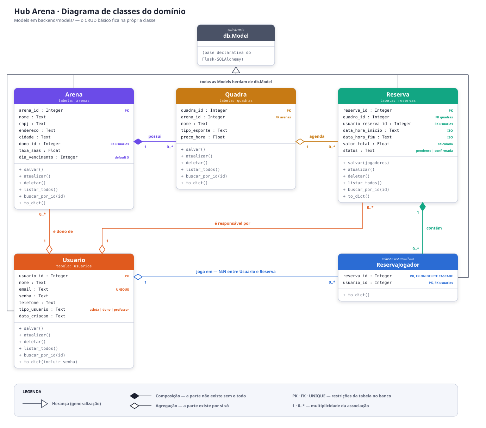
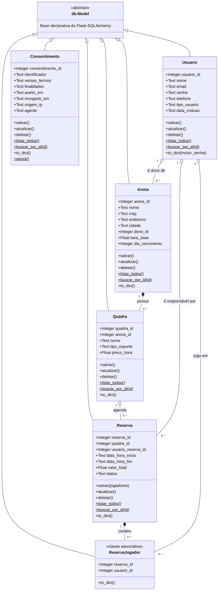

# Diagrama de classes do domínio — ArenaHub

Este diagrama representa as **Models** implementadas em
[`backend/models/`](../backend/models) e seus relacionamentos. Ele é coerente
com o código: cada classe corresponde a uma tabela do SQLite e cada associação
corresponde a uma chave estrangeira declarada nas Models.

> **Imagem:** [`diagrama-classes.svg`](diagrama-classes.svg) — mesma versão em
> arquivo de imagem, para usar em slides e no vídeo de demonstração.



---

## Diagrama (Mermaid)



---

## O Consentimento não se liga a ninguém, e isso é de propósito

`Consentimento` herda de `db.Model` como as outras, mas **não tem nenhuma
associação** — nem com `Usuario`. Não é esquecimento.

Ele registra o aceite dos termos porque a LGPD exige que o controlador
**comprove** o consentimento que obteve (Art. 8º, § 1º). Para isso ele guarda
um identificador **aleatório do navegador**, e não o `usuario_id`.

Uma chave estrangeira para `Usuario` ligaria cada aceite a uma pessoa
identificada — o oposto da minimização que a lei pede (Art. 6º, III) — e seria
desnecessária, já que o sistema não tem login. O campo `versao_termos` é o que
permite pedir novo aceite quando a política muda: consentimento dado para a
versão 1.0 não vale para a 2.0 (Art. 8º, § 6º).

`revogado_em` nulo significa vigente. Revogar **não apaga** a linha: o registro
é a prova do que aconteceu, inclusive da própria revogação.

## Herança

As cinco Models herdam de **`db.Model`**, a base declarativa do
Flask-SQLAlchemy (`backend/extensions.py`). É essa herança que mapeia cada
classe a uma tabela e dá acesso a `query`, `metadata` e à sessão do
SQLAlchemy.

O **CRUD básico permanece na própria Model**, como pede a arquitetura da
disciplina — `salvar()`, `atualizar()`, `deletar()`, `listar_todos()` e
`buscar_por_id()` são implementados em cada classe concreta, e não herdados de
`db.Model`. `Reserva.salvar(jogadores)` **redefine** a assinatura para gravar,
na mesma transação, a reserva e seus jogadores na tabela N:N.

## Composição e agregação

| Relacionamento | Tipo | Multiplicidade | Por quê | FK no código |
|---|---|---|---|---|
| `Arena` → `Quadra` | **Composição** | 1 → 0..* | Uma quadra não existe fora de uma arena: `arena_id` é `nullable=False` e a exclusão da arena é bloqueada enquanto houver quadras | `quadra.arena_id → arenas.arena_id` |
| `Reserva` → `ReservaJogador` | **Composição** | 1 → 0..* | O vínculo só existe enquanto a reserva existir — `ON DELETE CASCADE` apaga os jogadores junto com a reserva | `reserva_jogadores.reserva_id → reservas.reserva_id` |
| `Usuario` → `Arena` | Agregação | 1 → 0..* | O dono existe independentemente da arena; a arena apenas referencia um usuário do tipo `dono` | `arena.dono_id → usuarios.usuario_id` |
| `Quadra` → `Reserva` | Agregação | 1 → 0..* | A quadra existe sem reservas; a reserva aponta para a quadra agendada | `reserva.quadra_id → quadras.quadra_id` |
| `Usuario` → `Reserva` | Agregação | 1 → 0..* | Responsável pela reserva; o usuário existe por si só | `reserva.usuario_reserva_id → usuarios.usuario_id` |
| `Usuario` → `ReservaJogador` | Agregação | 1 → 0..* | O atleta existe independentemente das partidas que joga | `reserva_jogadores.usuario_id → usuarios.usuario_id` |

## Relação N:N

`Usuario` e `Reserva` têm uma relação **muitos-para-muitos**: uma reserva reúne
vários jogadores e um jogador participa de várias reservas. Ela é resolvida
pela **classe associativa `ReservaJogador`**
([`backend/models/reserva_jogador.py`](../backend/models/reserva_jogador.py)),
cuja chave primária é composta por `(reserva_id, usuario_id)`.

É essa tabela que alimenta o **ranking de atletas** (`sp_ranking_atletas`) e a
listagem de jogadores de cada reserva (`sp_jogadores_da_reserva`).

## Restrições que o diagrama reflete

- `usuarios.email` é **UNIQUE** — o cadastro recusa e-mail repetido.
- `usuarios.tipo_usuario` aceita `atleta`, `dono` ou `professor`; só usuários
  do tipo `dono` podem ser responsáveis por uma arena (regra no Service).
- `reservas.status` aceita `pendente` ou `confirmada`.
- `reservas.valor_total` **não vem do frontend**: é calculado no servidor como
  `horas × quadra.preco_hora`.
- As FKs são validadas pelo SQLite (`PRAGMA foreign_keys = ON`, ativado a cada
  conexão em `backend/app.py`), o que impede excluir registros com vínculos.

---

## Como este diagrama se encaixa na arquitetura

O diagrama acima é o **modelo de domínio** (camada Model). As demais camadas
operam sobre essas classes:

```
Tela (frontend/)  →  Controller (classe por recurso)
                     →  Service (classe por caso de uso)
                        →  Model (estas classes, CRUD básico)
                        →  Repository (consultas complexas via procedures)
                           →  SQLite
```

| Model | Controller | Repository |
|---|---|---|
| `Usuario` | `UsuarioController` | `UsuarioRepository` |
| `Arena` | `ArenaController` | `ArenaRepository` |
| `Quadra` | `QuadraController` | `QuadraRepository` |
| `Reserva`, `ReservaJogador` | `ReservaController` | `ReservaRepository` |
| `Consentimento` | `ConsentimentoController` | `ConsentimentoRepository` |
| *(agregações de todas)* | `RelatorioController` | `RelatorioRepository` |
